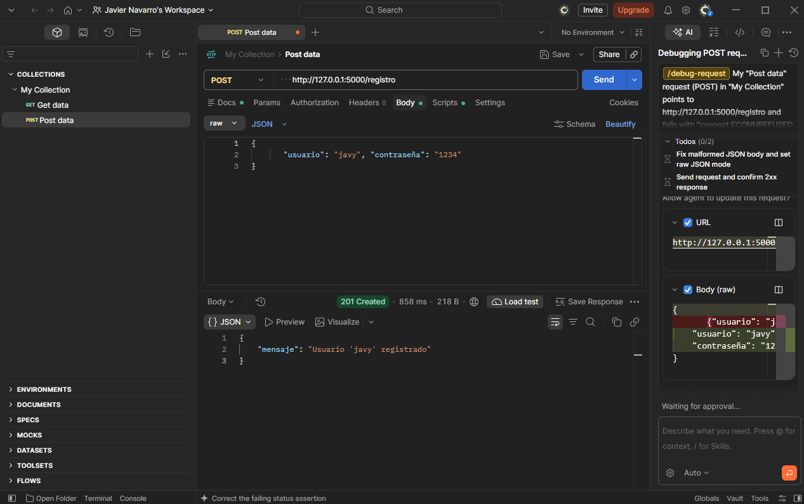
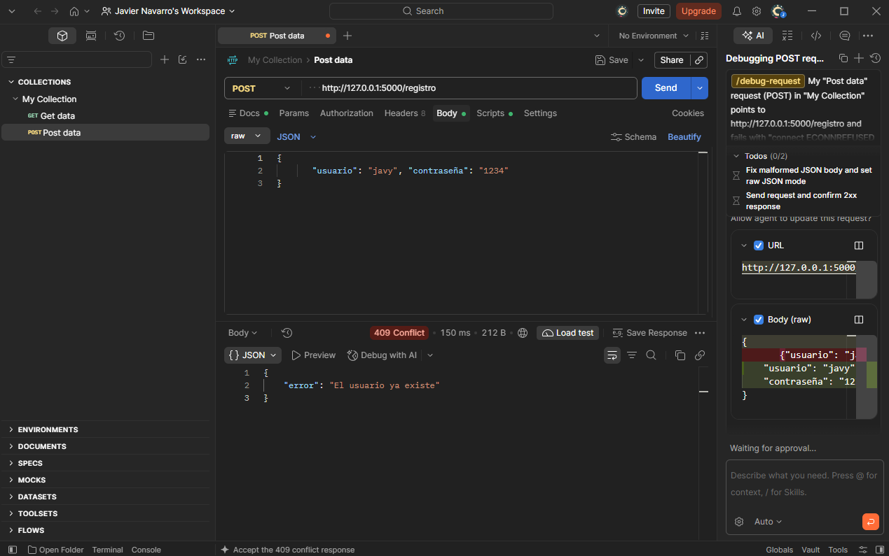
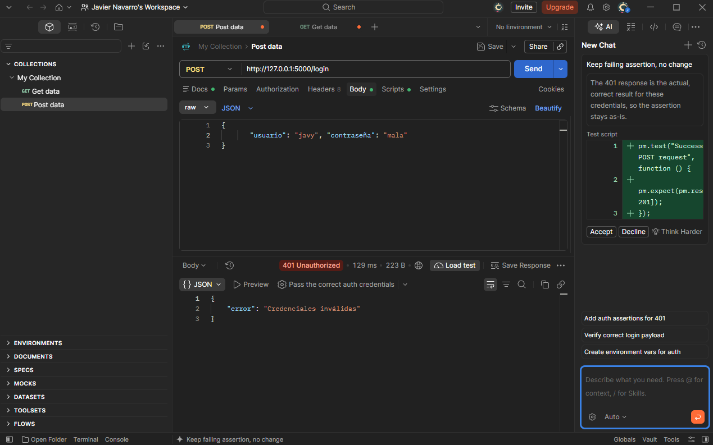
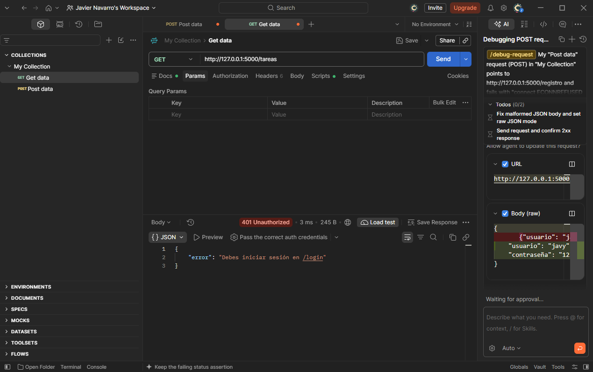
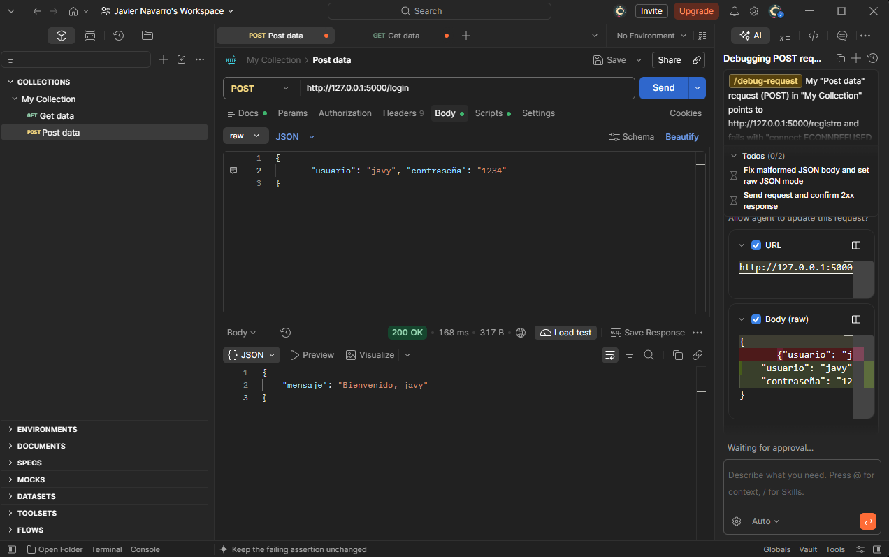
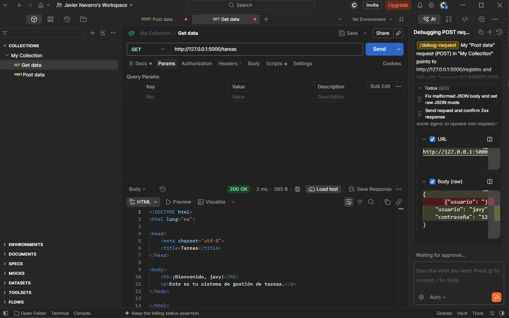
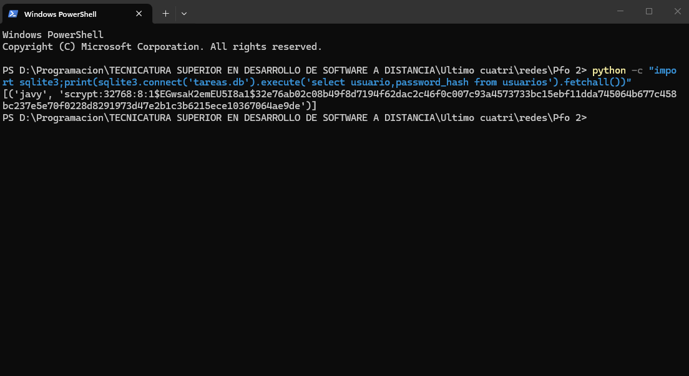

# PFO 2 – Sistema de Gestión de Tareas (API Flask + SQLite)

API REST con registro de usuarios, inicio de sesión y una página de bienvenida protegida.
Las contraseñas se guardan **hasheadas** (Werkzeug, scrypt + salt) en una base **SQLite**.

## Estructura
```
servidor.py        API Flask + SQLite
cliente.py         Cliente de consola
requirements.txt   Dependencias
capturas/          Capturas de pruebas exitosas
```

## Ejecución
```bash
git clone <https://github.com/Javier-Navarro-dev/pfo2-gestion-tareas.git>
cd <carpeta>
python -m venv venv
source venv/bin/activate        # Windows: venv\Scripts\activate
pip install -r requirements.txt
python servidor.py              # http://127.0.0.1:5000
```
La base `tareas.db` se crea sola al iniciar.

## Endpoints
| Método | Ruta | Descripción | Respuestas |
|---|---|---|---|
| POST | `/registro` | Crea usuario `{"usuario","contraseña"}` | 201 ok · 400 faltan datos · 409 ya existe |
| POST | `/login` | Verifica credenciales y abre sesión | 200 ok · 401 inválidas |
| GET | `/tareas` | HTML de bienvenida (requiere login) | 200 ok · 401 sin sesión |

## Pruebas con curl
```bash
# Registro
curl -X POST http://127.0.0.1:5000/registro -H "Content-Type: application/json" \
     -d '{"usuario":"javy","contraseña":"1234"}'

# Login (guarda la cookie de sesión en cookies.txt)
curl -c cookies.txt -X POST http://127.0.0.1:5000/login -H "Content-Type: application/json" \
     -d '{"usuario":"javy","contraseña":"1234"}'

# Tareas (usa la cookie)
curl -b cookies.txt http://127.0.0.1:5000/tareas
```
En Windows PowerShell usá `curl.exe` y comillas escapadas, o directamente el cliente de consola:
```bash
python cliente.py
```

## Capturas de pruebas (Postman)
| # | Prueba | Resultado |
|---|---|---|
| 1 | Registro de usuario | 201 Created |
| 2 | Registro duplicado | 409 Conflict |
| 3 | Login con contraseña incorrecta | 401 Unauthorized |
| 4 | `/tareas` sin sesión | 401 Unauthorized |
| 5 | Login correcto | 200 OK |
| 6 | `/tareas` con sesión (HTML de bienvenida) | 200 OK |
| 7 | Tabla `usuarios` con la contraseña hasheada | scrypt |









## GitHub Pages
GitHub Pages sólo aloja sitios estáticos, así que **no puede ejecutar Flask**. Se publica la
documentación del proyecto (README + capturas) en Pages: *Settings → Pages → Branch `main` → carpeta `/ (root)`*.
Para tener la API en línea, desplegarla aparte (PythonAnywhere, Render, etc.).

## Respuestas conceptuales

**¿Por qué hashear contraseñas?**
Si la base de datos se filtra, quien la obtenga vería todas las contraseñas en texto plano y podría
entrar a las cuentas (y probarlas en otros sitios, porque muchas personas reutilizan claves).
Un hash es una función de un solo sentido: no se puede revertir, y para validar se hashea lo que
ingresa el usuario y se compara con lo guardado. Con *salt* (valor aleatorio por usuario) dos claves
iguales generan hashes distintos, lo que frena las tablas precalculadas (rainbow tables), y un
algoritmo lento (scrypt, bcrypt) encarece los ataques de fuerza bruta.

**Ventajas de SQLite en este proyecto**
- No necesita servidor ni instalación: viene con Python (`sqlite3`).
- Toda la base es un único archivo (`tareas.db`), fácil de copiar, versionar y entregar.
- Cero configuración, ideal para desarrollo, pruebas y proyectos pequeños.
- Persistente: los datos sobreviven al reinicio del servidor.
- Soporta SQL estándar y restricciones (`UNIQUE`, `NOT NULL`) que evitan usuarios duplicados.
